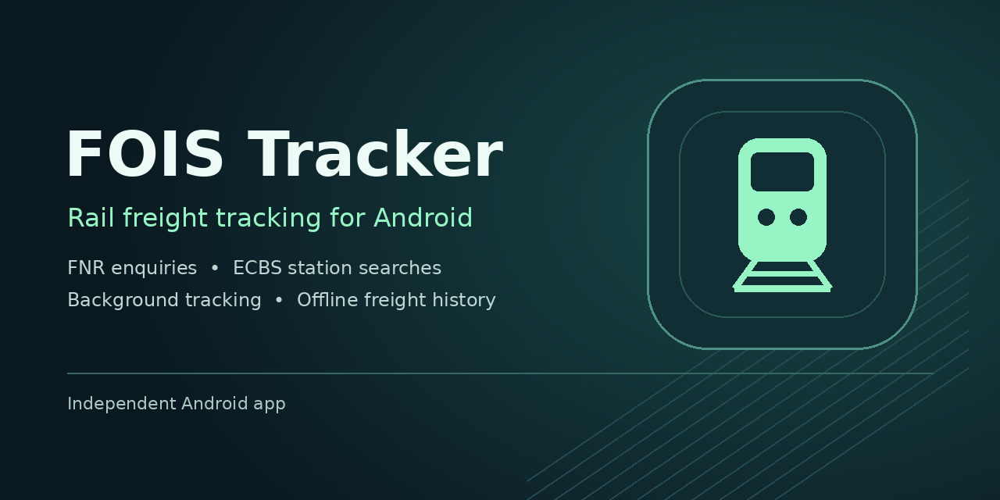

# FOIS Tracker



FOIS Tracker is an independent Android app for Indian Railways freight enquiries. Look up an FNR, search station pairs with an authorized ECBS account, and track saved freight with ETA alerts. Cached results are available offline and can be exported as PDF, CSV, or text. Indian Railways does not operate or endorse this app.

## Install

[Download FOIS-Tracker.apk](https://github.com/emochuddam/FOIS-Tracker/releases/download/v1.0.2-debug/FOIS-Tracker.apk) from the [GitHub prerelease](https://github.com/emochuddam/FOIS-Tracker/releases/tag/v1.0.2-debug). The APK runs on Android 8.0 and later, supports ARM64, and targets Android 16. A [SHA-256 checksum](https://github.com/emochuddam/FOIS-Tracker/releases/download/v1.0.2-debug/FOIS-Tracker.apk.sha256) is available alongside it.

Debug builds are signed for testing. Android requires the same signing certificate for an in-place update. A build signed on another runner or with another key may require a clean installation. The app retains the existing application ID and imports previous saved FNRs and the last cached public result when installed as an in-place update.

## Freight enquiries

The app uses a neutral Material 3 theme with elevated cards that follows the device. While an authenticated result is open in the foreground, live refresh starts a new check one second after the last request finishes. Refresh and pause status appear inline. The result still shows the latest movement reported by FOIS. On Android 13 and later, the app requests permission for notifications. You can also enable them under **Settings → Notifications**.

- Enter an 11-digit FNR on Home or Search. Guests enter the verification code shown by the official FOIS public enquiry form.
- Enter station codes such as **RMN CFS** or select stations from the autocomplete list. Use **Find stations on FOIS** for a name or code outside the local list. Station-pair enquiries open ECBS sign-in and resume the query when login succeeds. The consignor filter defaults to **FCI**, as in the original script, and is editable.
- Background refresh uses the current authorized ECBS session. Save an FNR and enable automatic tracking to schedule checks. The default is 15 minutes. Android may run checks later due to battery, network, or operating system scheduling. If ECBS ends the session, sign in again and complete verification to resume checks.
- The retrieval time and source are shown on result screens. Saved and previous results can be opened offline. Text, CSV and PDF reports can be saved with Android's document picker. Use **Copy report** to copy the full report to the clipboard.

## How FOIS access works

ECBS uses the portal's verification endpoint, dynamic PassSecure value, CryptoJS-compatible password encoding, RouterServlet login, and an authenticated home check. Public guest enquiries use the public form's own POST and a separate cookie jar. The app uses Android TLS certificate validation, requires user-entered verification and sends FOIS credentials only to the official HTTPS origin. Remembered credentials and reusable cookies are encrypted with an Android Keystore AES key. Fingerprint or strong biometric verification can lock the app. Sign-out clears the local authorized session and stored password.

A response can contain only ETA and a few other fields. The app labels missing values **Not Reported**. It uses reported arrival to confirm arrival, and station records to describe reported movement. It never derives a GPS position. The app does not assume an FNR belongs to a matching route unless the returned receipt or consignment details establish that association. Station autocomplete covers a bundled starter list and stations learned from cached FOIS responses. Online station lookup uses the official public Station Help form, independently of the freight enquiry. The supplied script contains no separate full journey or wagon endpoint. Available data, consignor scope, and results depend on FOIS and the authenticated account.

## Build and test

Requires JDK 17, Android SDK platform 36 and Android build tools 36.0.0. Gradle 8.13 is pinned by the wrapper.

```sh
./gradlew :app:testDebugUnitTest :app:assembleDebug :app:assembleDebugAndroidTest
./gradlew :app:connectedDebugAndroidTest
```

The signed debug APK is `app/build/outputs/apk/debug/app-debug.apk`. The GitHub workflow packages it as `FOIS-Tracker.apk` with a SHA-256 checksum and runs Android instrumentation against an API 36 emulator. Unit tests cover protocol and parsing with sanitized local HTTP fixtures. Device tests cover navigation, themes, SQLite persistence and alert deduplication, and PDF export. The live public and ECBS landing pages responded to unauthenticated HTTPS requests during development. Successful live FNR, authenticated lookups and enrolled fingerprint behavior require relevant inputs on a device.

To publish a signed release, configure repository secrets `FOIS_RELEASE_KEYSTORE_BASE64`, `FOIS_RELEASE_STORE_PASSWORD`, `FOIS_RELEASE_KEY_ALIAS`, and `FOIS_RELEASE_KEY_PASSWORD`, then manually run **Build FOIS APK** with a new release tag. For local signing, use `FOIS_RELEASE_KEYSTORE` with the file path and the three signing parameters as environment variables. Keep signing keys outside Git.

See [Dependencies](DEPENDENCIES.md) and the [Changelog](CHANGELOG.md).
